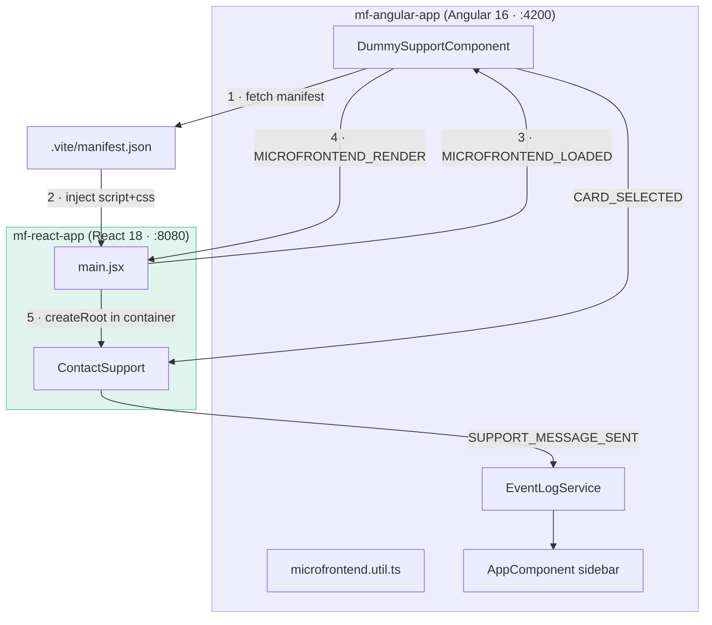
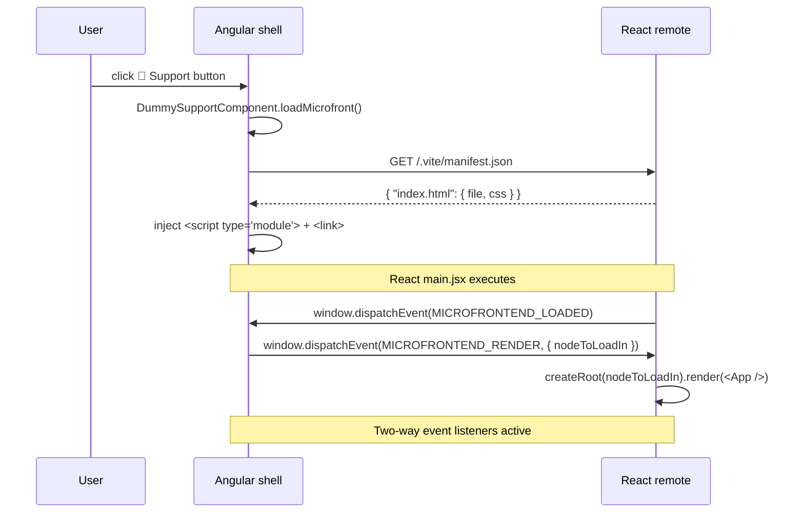

# mf-angular-app — Microfrontend Architecture

> Onboarding guide for developers joining this project.
> For run commands and environment setup, see the Quick Start section below or `README.md`.

## Overview

Angular 16 shell that hosts a React 18 remote (ContactSupport chat overlay) loaded at runtime. No Webpack Module Federation — the host fetches the Vite-generated `.vite/manifest.json` from the remote, extracts hashed JS/CSS filenames, injects `<script type="module">` and `<link rel="stylesheet">` into `<head>`, then coordinates mount via native DOM `CustomEvent`s. Both apps live in sibling directories under `projects/` and deploy independently to GitHub Pages.



### Apps at a glance

| App | Role | Framework | Port | Start command | Composition mechanism |
|-----|------|-----------|------|---------------|-----------------------|
| `mf-angular-app` | Shell / host | Angular 16 | 4200 (dev) · 4001 (preview) | `npm start` | Fetches `.vite/manifest.json`, injects scripts |
| `mf-react-app` | Remote MFE | React 18 + Vite | 3000 (dev) · 8080 (preview) | `npm run preview` | Emits `MICROFRONTEND_LOADED`, mounts on `MICROFRONTEND_RENDER` |

---

## Composition mechanism

The host uses a **Vite manifest + dynamic DOM injection** pattern. When the user clicks the Support button:

1. `DummySupportComponent.loadMicrofront()` delegates to `loadMicrofrontend()` in `microfrontend.util.ts`.
2. The util fetches `<origin>/.vite/manifest.json` (cache strategy varies by environment — see table below).
3. It reads `manifest['index.html'].file` for the entry JS and `manifest['index.html'].css[0]` for the stylesheet.
4. It injects a `<script type="module">` and a `<link rel="stylesheet">` into `<head>`.
5. React's `main.jsx` executes, detects it is not in bootstrap mode, dispatches `MICROFRONTEND_LOADED`.
6. The host receives `MICROFRONTEND_LOADED`, dispatches `MICROFRONTEND_RENDER` with the container `HTMLElement`.
7. React mounts `<App />` into that element via `createRoot`.

There is no shared module negotiation. Each app bundles its own dependencies. Framework versions do not need to match.

### Environment matrix

| Angular config | React origin | Cache strategy | When to use |
|---|---|---|---|
| `local` (default) | `http://127.0.0.1:8080` | `no-store` | Full local dev |
| `development` | `https://nicolasticona.github.io/mf-react-app` | `no-cache` | Angular local + React on GitHub Pages |
| `production` | `https://nicolasticona.github.io/mf-react-app` | `no-cache` | Production (GitHub Pages) |

`no-store` always re-fetches the manifest. `no-cache` revalidates via ETag — returns a fast `304 Not Modified` when unchanged.

---

## Bootstrap and orchestration sequence



### Step-by-step

1. User clicks the Support button in `HeaderComponent`.
2. `DummySupportComponent.loadMicrofront()` guards against double-load (`alreadyLoaded` flag).
3. Registers `MICROFRONTEND_LOADED` listener (`{ once: true }`) and `MICROFRONTEND_RENDER` listener (`{ once: true }`).
4. Registers persistent listeners for `SUPPORT_MESSAGE_SENT` and `CARD_SELECTED` (for event log).
5. Calls `loadMicrofrontend('react-app', containerElement)`.
6. `microfrontend.util.ts` reads `environment.microfrontends['react-app']`, picks the `vite` handler.
7. Fetches `manifestPath` with the configured `cacheStrategy`.
8. Registers a one-time `MICROFRONTEND_LOADED` listener inside the util to dispatch `MICROFRONTEND_RENDER`.
9. Creates and appends `<script type="module" src="…">` and `<link rel="stylesheet" href="…">`.
10. React `main.jsx` runs; `isBootstrap` is `false` (origin not whitelisted); dispatches `MICROFRONTEND_LOADED`.
11. Util listener fires → dispatches `MICROFRONTEND_RENDER` with `{ name, nodeToLoadIn }`.
12. React `main.jsx` `MICROFRONTEND_RENDER` listener fires → `createRoot(detail.nodeToLoadIn).render(…)`.

### Key entry files

```typescript
// src/app/utils/microfrontend.util.ts — manifest fetch + script injection
async function loadViteMicrofrontend(microfrontend: Microfrontend, nodeToLoadIn: HTMLElement) {
    const response = await fetch(microfrontend.manifestPath, { cache: microfrontend.cacheStrategy ?? 'no-store' });
    const manifest = await response.json();

    window.addEventListener('MICROFRONTEND_LOADED', (event: Event) => {
        const customEvent = event as CustomEvent;
        if (customEvent.detail.name === microfrontend.name) {
            const renderEvent = new CustomEvent('MICROFRONTEND_RENDER', {
                detail: { nodeToLoadIn, name: microfrontend.name }
            });
            window.dispatchEvent(renderEvent);
        }
    });

    const index = manifest['index.html'];
    const script = document.createElement('script');
    script.src = `${microfrontend.origin}/${index.file}`;
    script.type = 'module';
    const css = document.createElement('link');
    css.rel = 'stylesheet';
    css.href = `${microfrontend.origin}/${index.css[0]}`;
    document.head.appendChild(script);
    document.head.appendChild(css);
}
```

```javascript
// mf-react-app/src/main.jsx — dual-mode bootstrap
if (isBootstrap) {
    createRoot(document.getElementById("react-root")).render(<StrictMode><App /></StrictMode>);
} else {
    window.addEventListener("MICROFRONTEND_RENDER", ({ detail }) => {
        if (detail.name === "react-app") {
            createRoot(detail.nodeToLoadIn).render(<StrictMode><App /></StrictMode>);
        }
    });
    window.dispatchEvent(new CustomEvent("MICROFRONTEND_LOADED", { detail: { name: "react-app" } }));
}
```

---

## Host app

| Concern | File | What it does |
|---|---|---|
| MFE load trigger | `src/app/components/dummy-support/dummy-support.component.ts` | Calls `loadMicrofrontend()`, registers all event listeners, guards double-load |
| Composition util | `src/app/utils/microfrontend.util.ts` | Fetches manifest, injects scripts, dispatches `MICROFRONTEND_RENDER` |
| App bootstrap | `src/main.ts` | `platformBrowserDynamic().bootstrapModule(AppModule)` |
| Root module | `src/app/app.module.ts` | Declares `AppComponent`, imports standalone components |
| Log state | `src/app/services/event-log.service.ts` | Root singleton; `push()` / `clear()` |
| Log display | `src/app/app.component.html` | `<aside class="event-log-sidebar">` renders `eventLog.events` |
| Environment typing | `src/environments/environment.type.ts` | `Environment` and `Microfrontend` types |
| Build config | `angular.json` | Three configurations: `local`, `development`, `production` |
| Manifest generation | `generate-manifest.js` | Post-build: scans `dist/`, writes `dist/manifest.json` |

### How the host loads remotes

```typescript
// src/app/components/dummy-support/dummy-support.component.ts
public loadMicrofront() {
    if (this.alreadyLoaded) return;
    if (!this.microfrontContainer) return;

    loadMicrofrontend(
        environment.microfrontends['react-app'].name,
        this.microfrontContainer.nativeElement
    );

    this.alreadyLoaded = true;
}
```

`loadMicrofrontend` checks `allowedMicrofrontendNames` then dispatches to `microfrontendLoadHandlers['vite']`. The `angular` handler stub exists for future use.

### Cross-app communication (host side)

```typescript
// src/app/components/card/card.component.ts — dispatches CARD_SELECTED on click
onClick() {
    window.dispatchEvent(new CustomEvent('CARD_SELECTED', {
        detail: { title: this.title, content: this.content }
    }));
}

// src/app/components/dummy-support/dummy-support.component.ts — persistent listeners
window.addEventListener('SUPPORT_MESSAGE_SENT', (event: Event) => {
    const ce = event as CustomEvent;
    this.zone.run(() => {
        this.eventLog.push(`💬 User → Angular: "${ce.detail.message}"`);
    });
});

window.addEventListener('CARD_SELECTED', (event: Event) => {
    const ce = event as CustomEvent;
    this.zone.run(() => {
        this.eventLog.push(`📌 Angular → React: "${ce.detail.title}"`);
    });
});
```

All native DOM event callbacks use `NgZone.run()` so Angular change detection fires correctly.

---

## Remote MFE

### mf-react-app

| Layer | File | Role |
|---|---|---|
| Entry / bootstrap | `src/main.jsx` | Dual-mode detection; dispatches `MICROFRONTEND_LOADED`; mounts on `MICROFRONTEND_RENDER` |
| App root | `src/App.jsx` | Renders `<ContactSupport />` |
| Chat UI | `src/components/ContactSupport/ContactSupport.jsx` | Listens `CARD_SELECTED`, dispatches `SUPPORT_MESSAGE_SENT` |
| Styles | `src/components/ContactSupport/ContactSupport.css` | Dark theme; all classes prefixed `cs-` |
| Bootstrap detection | `src/constants/app.constants.js` | `isBootstrap` flag — origin whitelist + pathname check |
| Environment setup | `src/environments/setup-environment.js` | Copies `environment.<ENV>.js` → `environment.js` at build time |
| Build config | `vite.config.js` | `build.manifest: true`; `base: VITE_BASE_PATH ?? '/'` |

#### Exposed module / integration contract

The remote exports no module. The integration contract is purely event-based:

- Dispatches `MICROFRONTEND_LOADED` on script load (hosted mode only).
- Listens for `MICROFRONTEND_RENDER` — mounts into `detail.nodeToLoadIn`.
- Listens for `CARD_SELECTED` — pushes card message into chat state.
- Dispatches `SUPPORT_MESSAGE_SENT` when user presses Enter in the chat input.

#### Bootstrap detection

```javascript
// src/constants/app.constants.js
const whiteListBootstrap = ['http://localhost:3000', 'http://127.0.0.1:8080'];

export const isBootstrap =
    whiteListBootstrap.includes(window.location.origin) ||
    window.location.pathname.startsWith('/mf-react-app');
```

The pathname check handles GitHub Pages where both apps share `https://nicolasticona.github.io` — origin-only whitelisting would falsely treat the Angular shell as bootstrap mode.

#### Cross-app communication (remote side)

```jsx
// src/components/ContactSupport/ContactSupport.jsx
useEffect(() => {
    const handler = (e) => {
        setMessages(prev => [...prev, { type: 'card', title: e.detail.title, content: e.detail.content }]);
    };
    window.addEventListener('CARD_SELECTED', handler);
    return () => window.removeEventListener('CARD_SELECTED', handler);
}, []);

const handleKeyUp = (event) => {
    if (event.key === "Enter" && event.target.value.trim()) {
        const message = event.target.value.trim();
        window.dispatchEvent(new CustomEvent('SUPPORT_MESSAGE_SENT', { detail: { message } }));
        setMessages(prev => [...prev, { type: 'user', text: message }]);
        event.target.value = "";
    }
};
```

---

## Cross-app communication

All communication uses native DOM `CustomEvent`s on `window`. No shared state, no framework bridge.

### Event protocol

| Event | Direction | Payload | When |
|---|---|---|---|
| `MICROFRONTEND_LOADED` | React → Angular | `{ name: "react-app" }` | Scripts loaded, awaiting mount |
| `MICROFRONTEND_RENDER` | Angular → React | `{ name: "react-app", nodeToLoadIn: HTMLElement }` | Mount into this container |
| `CARD_SELECTED` | Angular → React | `{ title: string, content: string }` | User clicks a topic card |
| `SUPPORT_MESSAGE_SENT` | React → Angular | `{ message: string }` | User sends a message in chat |

### Full event flow

```
[Angular: card click]
    └─> window.dispatchEvent(CARD_SELECTED { title, content })
            ├─> React useEffect handler → push card message into chat UI
            └─> Angular CARD_SELECTED listener → eventLog.push("📌 Angular → React: …")

[React: Enter in chat input]
    └─> window.dispatchEvent(SUPPORT_MESSAGE_SENT { message })
            ├─> Angular SUPPORT_MESSAGE_SENT listener → eventLog.push("💬 User → Angular: …")
            └─> React setState → push user message into chat UI
```

---

## Build artifacts

### mf-react-app (`dist/`)

| File | Purpose |
|---|---|
| `.vite/manifest.json` | Maps `index.html` to hashed JS/CSS filenames; read by Angular host at runtime |
| `assets/index-<hash>.js` | React app bundle (entry point) |
| `assets/index-<hash>.css` | Stylesheet |
| `index.html` | Standalone entry (bootstrap mode only) |

### mf-angular-app (`dist/`)

| File | Purpose |
|---|---|
| `manifest.json` | Custom manifest: `{ scripts, styles }` — enables this shell to be consumed as a remote |
| `main.<hash>.js` | Angular app bundle |
| `runtime.<hash>.js` | Angular runtime |
| `polyfills.<hash>.js` | Angular polyfills |
| `styles.<hash>.css` | Global styles |
| `index.html` | App shell |
| `404.html` | Copy of `index.html` for GitHub Pages deep-link handling |

---

## Local dev workflow

**React must start first** — Angular fetches the manifest at boot.

```bash
# Terminal 1 — React remote (must be running before Angular)
cd projects/mf-react-app
npm install
npm run preview          # builds dev env, serves dist/ on http://127.0.0.1:8080

# Terminal 2 — Angular shell
cd projects/mf-angular-app
npm install
npm start                # ng serve with local config → http://localhost:4200
```

Open `http://localhost:4200` and click **💬 Support**.

> **Why `preview` for React?** Vite's `dev` server does not generate `manifest.json` — only a production/preview build does. `npm run preview` runs `build:dev` then serves `dist/` via `http-server`.

---

## Adding a new remote

1. Build the remote with Vite (`build.manifest: true` in `vite.config.js`). Confirm `.vite/manifest.json` is produced.
2. Add the remote to `allowedMicrofrontendNames` in `src/app/utils/microfrontend.util.ts`.
3. Add a handler to `microfrontendLoadHandlers` (or reuse `'vite'`).
4. Add an environment entry for each config file:
   - `src/environments/environment.ts` — local origin + `manifestPath`
   - `src/environments/environment.local.ts` — same
   - `src/environments/environment.development.ts` — deployed origin, `cacheStrategy: 'no-cache'`
   - `src/environments/environment.production.ts` — deployed origin, `cacheStrategy: 'no-cache'`
5. The `Microfrontend` type (`environment.type.ts`) already covers `name`, `origin`, `manifestPath`, `buildType`, `cacheStrategy` — no type changes needed.
6. Create a host component (similar to `DummySupportComponent`) with a `@ViewChild` container and a trigger that calls `loadMicrofrontend('<new-name>', containerEl)`.
7. In the remote's `main.jsx`/`main.ts`, implement the same dual-mode pattern: check `isBootstrap`, else dispatch `MICROFRONTEND_LOADED` and listen for `MICROFRONTEND_RENDER`.
8. Add the new remote's origin to the CORS/CSP configuration if applicable.
9. If the remote is on a new domain, add it to `isBootstrap` whitelist logic in the remote.

**Naming invariant**: the string `'react-app'` (or your new remote name) must match across:
- `environment.microfrontends['<name>']` key
- `allowedMicrofrontendNames` array
- `MICROFRONTEND_LOADED` event `detail.name`
- `MICROFRONTEND_RENDER` event `detail.name` check in the remote

---

## Common pitfalls

| Symptom | Cause | Fix |
|---|---|---|
| Manifest 404 in local dev | React app not running, or running with `npm run dev` instead of `npm run preview` | Run `npm run preview` in mf-react-app — `dev` mode does not emit a manifest |
| Angular change detection not updating after event | Native DOM listener runs outside Angular zone | Wrap callback in `this.zone.run(() => { … })` |
| React mounts standalone on GitHub Pages instead of waiting | `isBootstrap` pathname check missing or wrong base path | Ensure `window.location.pathname.startsWith('/mf-react-app')` and `VITE_BASE_PATH=/mf-react-app/` at build time |
| Manifest 404 on GitHub Pages | Jekyll drops `.vite/` directory (leading dot) | Ensure `public/.nojekyll` exists in mf-react-app |
| Angular deep links 404 on GitHub Pages | GitHub Pages serves 404 for unknown paths | `cp dist/index.html dist/404.html` in deploy step (already in CI) |
| React MFE styles bleed into Angular | Missing CSS namespace prefix | Prefix all ContactSupport classes with `cs-` (already done) |
| Double-load of React MFE | Support button clicked multiple times | `alreadyLoaded` guard in `DummySupportComponent` prevents re-entry |

---

## Further reading

- [@vitejs/plugin-react@4.3.3](https://www.npmjs.com/package/@vitejs/plugin-react) — Vite plugin for React fast refresh and JSX transform
- [vite@5.4.9](https://www.npmjs.com/package/vite) — build tool; `build.manifest: true` produces `.vite/manifest.json`
- [http-server@14.1.1](https://www.npmjs.com/package/http-server) — serves `dist/` locally for preview mode in both apps
- [@angular/core@16.2.x](https://www.npmjs.com/package/@angular/core) — Angular 16 framework; standalone components pattern used throughout
- [zone.js@0.13.x](https://www.npmjs.com/package/zone.js) — Angular change detection; `NgZone.run()` required for native DOM event callbacks
- [rxjs@7.8.x](https://www.npmjs.com/package/rxjs) — available in Angular app (dependency); not used for cross-app communication in this project
